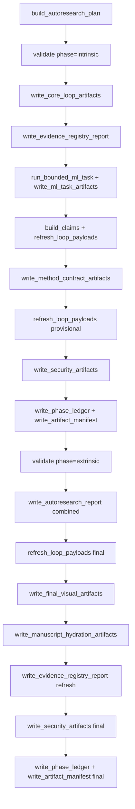

# template_autoresearch_project

Public exemplar for a deterministic bounded AutoResearch workflow over a small
local machine-learning task.

This project demonstrates a file-backed AutoResearch loop that runs inside the
normal template pipeline. The case study uses a local balanced MNIST subset, a
nearest-centroid baseline, and a bounded set of numpy-only neural-network
candidates: softmax regression, a small MLP, and a tiny patch-attention
classifier.

## When to use this template

Use this template when you need a **bounded, offline AutoResearch loop**:
deterministic ML candidate evaluation over a fixed local dataset, with
evidence-linked claims, machine-readable ledgers, artifact-integrity
manifests, and deferred human-review gates. It demonstrates how to make the
research *process* inspectable without claiming autonomous discovery.
Metric claims come from local execution artifacts: benchmark-style command
output may use exact `METRIC name=value` lines, candidate outcomes stay in
explicit keep/reject/defer-style ledgers, and confidence claims must disclose
baseline, best result, and the measurable noise floor rather than standing in
for human publication approval.

Choose [`template_autoscientists`](https://github.com/docxology/template/blob/main/projects/templates/template_autoscientists) instead if
your focus is agent-team **coordination primitives** (dead-end registries,
noise-band confirmation, stagnation-driven reorganization) rather than
AutoResearch loop infrastructure. For the full exemplar roster see
[`projects/AGENTS.md`](https://github.com/docxology/template/blob/main/projects/AGENTS.md#permanent-canonical-exemplars).

## Publication and rendering

The publishing metadata and per-platform status below are **compiled from
`docs/manuscript/config.yaml`** by `infrastructure.publishing.status_report` — do not
hand-edit between the markers. From the pinned runner root with `project` set
as in the runbook, use

```sh
uv run python -m infrastructure.publishing.status_report --project "$project" \
  --config "$project/docs/manuscript/config.yaml" --write
```

The pinned generator prints the former path in its legend. Supply the
explicit `--config` path above for this checkout.

<!-- PUBLISHING-STATUS:START (generated by infrastructure.publishing.status_report) -->
**Bounded AutoResearch for a Tiny Reproducible Machine-Learning Task** · v0.3.2 · MIT · Daniel Ari Friedman

Concept DOI: [10.5281/zenodo.20417016](https://doi.org/10.5281/zenodo.20417016) | Version DOI: [10.5281/zenodo.20931907](https://zenodo.org/records/20931907) | Repository: [docxology/template_autoresearch_project](https://github.com/docxology/template_autoresearch_project)

Publishing surface — 20 platforms, 9 published:

| Platform | Tier | Status | Reference | Credentials |
| --- | --- | --- | --- | --- |
| zenodo | first-class | ✅ published | [10.5281/zenodo.20417016](https://doi.org/10.5281/zenodo.20417016) | `ZENODO_API_TOKEN` |
| github | first-class | ✅ published | [docxology/template_autoresearch_project](https://github.com/docxology/template_autoresearch_project) | `GITHUB_TOKEN` |
| arxiv | first-class | ⚪ available | — | — |
| pypi | first-class | ✅ published | [https://test.pypi.org/project/template-autoresearch-project/0.3.2/](https://test.pypi.org/project/template-autoresearch-project/0.3.2/) | `PYPI_TOKEN`, `TESTPYPI_TOKEN` |
| ipfs_pinata | first-class | ✅ published | [https://gateway.pinata.cloud/ipfs/QmZvS2v7ZpqS4T8ZufeW9sA4gNBteAdVfmLH4LcoAqrUhv](https://gateway.pinata.cloud/ipfs/QmZvS2v7ZpqS4T8ZufeW9sA4gNBteAdVfmLH4LcoAqrUhv) | `PINATA_JWT` |
| ipfs_web3storage | first-class | ⚪ available | — | `WEB3_STORAGE_TOKEN` |
| software_heritage | first-class | ✅ published | [https://archive.softwareheritage.org/browse/origin/?origin_url=https://github.com/docxology/template_autoresearch_project](https://archive.softwareheritage.org/browse/origin/?origin_url=https://github.com/docxology/template_autoresearch_project) | — |
| github_pages | first-class | ✅ published | [https://docxology.github.io/template_autoresearch_project/](https://docxology.github.io/template_autoresearch_project/) | `GITHUB_TOKEN` |
| cloudflare_pages | first-class | ⚪ available | — | `CLOUDFLARE_API_TOKEN` |
| netlify | first-class | ✅ published | [https://6a443f868786d30c7d8ea014--tranquil-kleicha-0c9203.netlify.app](https://6a443f868786d30c7d8ea014--tranquil-kleicha-0c9203.netlify.app) | `NETLIFY_AUTH_TOKEN` |
| huggingface_hub | first-class | ✅ published | [https://huggingface.co/datasets/ActiveInference/template_autoresearch_project](https://huggingface.co/datasets/ActiveInference/template_autoresearch_project) | `HUGGINGFACE_TOKEN`, `HF_TOKEN` |
| osf | first-class | ✅ published | [https://osf.io/geykb/](https://osf.io/geykb/) | `OSF_TOKEN` |
| amazon_kdp | documented | 🟡 planned | — | `AMAZON_KDP_EMAIL`, `AMAZON_KDP_PASSWORD` |
| google_play_books | documented | 🟡 planned | — | `GOOGLE_PLAY_BOOKS_SERVICE_ACCOUNT_JSON` |
| gumroad | documented | 🟡 planned | — | `GUMROAD_ACCESS_TOKEN` |
| leanpub | documented | 🟡 planned | — | `LEANPUB_API_KEY` |
| lulu | documented | 🟡 planned | — | `LULU_CLIENT_KEY`, `LULU_CLIENT_SECRET` |
| draft2digital | documented | 🟡 planned | — | `DRAFT2DIGITAL_API_TOKEN` |
| stripe | documented | 🟡 planned | — | `STRIPE_SECRET_KEY`, `STRIPE_PUBLISHABLE_KEY` |
| ingramspark | documented | 🟡 planned | — | `INGRAMSPARK_CLIENT_ID`, `INGRAMSPARK_CLIENT_SECRET` |

_Keywords: autoresearch, reproducible research, machine learning benchmark, artifact readiness, human review, local artifact integrity._

_Status legend: ✅ published (durable identifier recorded in `config.yaml`) · 🔵 reserved (identifier reserved but not yet registered by final publication) · ⚪ available (adapter implemented and locally verifiable) · 🟡 planned. This block is generated — edit `docs/manuscript/config.yaml`, then use the regeneration command above._
<!-- PUBLISHING-STATUS:END -->

The 3 platforms still shown ⚪ available are not automatable to "published" with
current tooling/credentials, not an oversight: **arXiv** has no submission API
in this codebase (`infrastructure.publishing.arxiv` only prepares a local
tarball — a human must upload it via arxiv.org and the resulting `arxiv` URL
would then be added to `publication.published_artifacts`); **Cloudflare
Pages** needs a `CLOUDFLARE_ACCOUNT_ID` the configured API token cannot
auto-discover; **IPFS (Web3.Storage)** has no `WEB3_STORAGE_TOKEN` configured.

The [documentation index](docs/README.md) covers the protocol, configuration,
and artifacts. Use the [pinned runbook](docs/runbook.md) to build this
checkout. The tracked [published output](output/) is a reference snapshot.

## Configuration

Use [`docs/manuscript/config.yaml`](docs/manuscript/config.yaml) as the live metadata,
render, analysis, project-config, approval-boundary, and publication surface.
Keep [`docs/manuscript/config.yaml.example`](docs/manuscript/config.yaml.example) in
top-level parity with placeholder-safe values so a fork can start without
project-specific secrets or release metadata. The bounded ML task, source
ledger, human-review boundary, and generated artifact contracts remain
offline-first and deterministic.

## Running the project

Follow the [runbook](docs/runbook.md) for native tests, the offline source
audit, deterministic analysis, manuscript rendering, and validation.

## Loop orchestration



Project-specific docs live in [`docs/`](docs/).
The project-level next-work roadmap lives in [`TODO.md`](docs/TODO.md).

## Outputs

- `output/data/autoresearch_plan.json`
- `output/data/autoresearch_loop.json`
- `output/data/autoresearch_claims.json`
- `output/data/autoresearch_stage_matrix.csv`
- `output/data/autoresearch_review_packet.json`
- `output/data/research_program.json`
- `output/data/idea_ledger.json`
- `output/data/run_ledger.json`
- `output/data/review_decisions.json`
- `output/data/benchmark_scores.json`
- `output/data/mnist_task_config.json`
- `output/data/ml_task_results.json`
- `output/data/ml_candidate_ledger.json`
- `output/data/ml_confusion_matrix.csv`
- `output/data/ml_training_history.csv`
- `output/data/ml_error_examples.json`
- `output/data/ml_prediction_records.json`
- `output/data/ml_classification_diagnostics.json`
- `output/data/ml_candidate_intervals.json`
- `output/data/ml_class_balance.json`
- `output/data/ml_calibration_report.json`
- `output/data/ml_calibration_bin_intervals.json`
- `output/data/ml_robustness_report.json`
- `output/data/ml_probability_diagnostics.json`
- `output/data/ml_bootstrap_intervals.json`
- `output/data/ml_paired_comparison.json`
- `output/data/ml_statistical_summary.json`
- `output/data/ml_training_diagnostics.json`
- `output/data/ml_candidate_rank_stability.json`
- `output/data/ml_candidate_selection_audit.json`
- `output/data/ml_diagnostic_boundary.json`
- `output/data/autoresearch_phase_ledger.json`
- `output/data/figure_quality_report.json`
- `output/data/autoresearch_security_profile.json`
- `output/data/autoresearch_threat_model.json`
- `output/data/autoresearch_supply_chain_inventory.json`
- `output/data/autoresearch_inventory_export.json`
- `output/data/autoresearch_integrity_attestation.json`
- `output/data/autoresearch_schema_manifest.json`
- `output/data/research_object_manifest.json`
- `output/data/manuscript_variables.json`
- `output/data/manuscript_variable_provenance.json`
- `output/data/manuscript_figure_blocks.json`
- `output/data/autoresearch_evidence_overview.json`
- `output/data/benchmark_boundary.json`
- `output/reports/autoresearch_evidence_overview.md`
- `output/data/publication_ledger.json` — release-stage; written by `write_transmission_bookends()` when `docs/manuscript/config.yaml`'s `publication.transmission_bookends.enabled` is `true` (see [`docs/guides/publishing-guide.md`](https://github.com/docxology/template/blob/main/docs/guides/publishing-guide.md))
- `output/data/transmission_manifest.json` — release-stage; see `publication.transmission_bookends` above
- `output/figures/autoresearch_stage_matrix.png`
- `output/figures/ml_candidate_scores.png`
- `output/figures/ml_confusion_matrix.png`
- `output/figures/ml_per_class_accuracy.png`
- `output/figures/ml_learning_curves.png`
- `output/figures/ml_complexity_accuracy.png`
- `output/figures/mnist_error_examples.png`
- `output/figures/ml_calibration_reliability.png`
- `output/figures/ml_classification_metrics_heatmap.png`
- `output/figures/ml_confusion_pairs.png`
- `output/figures/ml_generalization_gap.png`
- `output/figures/ml_robustness_matrix.png`
- `output/figures/ml_probability_margin_distribution.png`
- `output/figures/ml_bootstrap_intervals.png`
- `output/figures/ml_paired_correctness.png`
- `output/figures/ml_selective_accuracy.png`
- `output/figures/ml_probability_quality.png`
- `output/figures/ml_training_dynamics.png`
- `output/figures/ml_candidate_rank_stability.png`
- `output/figures/autoresearch_candidate_lifecycle.png`
- `output/figures/mnist_class_balance.png`
- `output/figures/mnist_subset_contact_sheet.png`
- `output/figures/autoresearch_closure_flow.png`
- `output/figures/autoresearch_security_control_matrix.png`
- `output/figures/autoresearch_integrity_chain.png`
- `output/figures/transmission_integrity_strip.png` — release-stage; see `publication.transmission_bookends` note above
- `output/figures/transmission_pairing.png` — release-stage; see `publication.transmission_bookends` note above
- `output/figures/figure_registry.json`
- `output/reports/autoresearch_loop.json`
- `output/reports/autoresearch_loop.md`
- `output/reports/autoresearch_review_packet.md`
- `output/reports/autoresearch_summary.md`
- `output/reports/autoresearch_security_review.md`
- `output/reports/ml_experiment_report.md`
- `output/reports/ml_benchmark_score.json`
- `output/reports/autoresearch_readiness.json`
- `output/reports/autoresearch_readiness.md`
- `output/reports/benchmark_readiness_smoke.json`
- `output/reports/evidence_registry.json`
- `output/reports/artifact_manifest.json`

`output/reports/evidence_registry.json` is intentionally a compact summary, not
the full validation registry. Full fact serialization is opt-in with
`TEMPLATE_EVIDENCE_REGISTRY_FULL=1` and is not a required artifact.

<!-- foam-orphan-nav:start (hand-maintained: links sub-docs so they are reachable; no generator refreshes or validates this block) -->

## Directory & sub-document map

Navigation links to in-tree documents (keeps them discoverable):

- [Data Notes](data/AGENTS.md)
- [Data](data/README.md)
- [Human-authored research program](program.md)
- [Scripts - Agent Notes](scripts/AGENTS.md)
- [Scripts](scripts/README.md)

<!-- foam-orphan-nav:end -->
